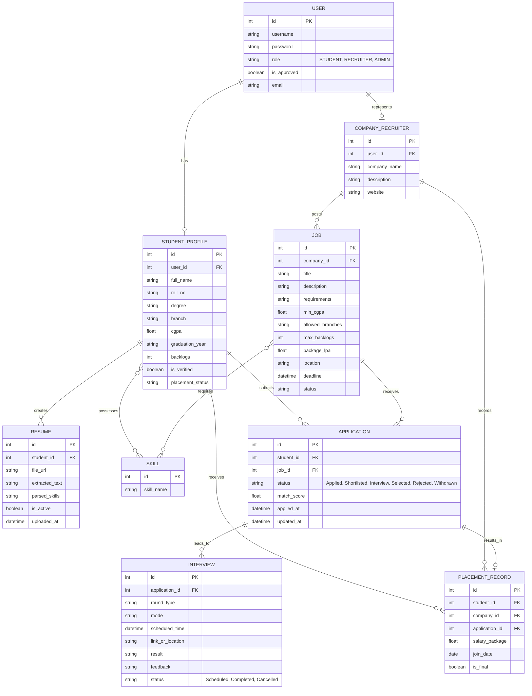

# Placement Portal - System Specification

## 1. Overview
The Placement Portal is a centralized platform designed to streamline the campus recruitment process. It connects students, recruiters, and placement administrators, facilitating everything from student profile management and job postings to application tracking and interview scheduling.

## 2. Tech Stack
*   **Backend:** Django, SQLite (Development), PostgreSQL (Production)
*   **Frontend:** Tailwind CSS
*   **AI/ML:** spaCy (NLP), pdfplumber (PDF parsing), scikit-learn (TF-IDF matching)

## 3. User Roles
*   **Student:** Can create and manage profiles, upload resumes, browse job postings, check eligibility, apply for jobs, and track application status.
*   **Recruiter (Company):** Can post job openings, define eligibility criteria, review student applications, shortlist candidates, and schedule interviews.
*   **Placement Admin:** Has full oversight of the system. Can manage users, approve job postings, monitor placement activities, resolve disputes, and generate reports.

## 4. Core Modules
1.  **Authentication & Authorization:** Secure login/registration for all roles with role-based access control (RBAC).
2.  **Student Profile & Resume Management:** Allows students to build detailed profiles (academics, skills, projects) and upload/generate resumes.
3.  **Job Postings:** Enables recruiters to create, manage, and publish job opportunities with specific requirements.
4.  **Eligibility Check Engine:** Automatically matches student profiles against job eligibility criteria (e.g., GPA, degree, skills) before allowing applications.
5.  **Applications Management:** Handles the submission, tracking, and status updates of job applications.
6.  **Interview Scheduling:** Facilitates scheduling, managing, and notifying users about upcoming interviews.
7.  **Placement Records:** Maintains a historical record of successful placements, offers accepted, and company recruitment statistics.
8.  **Reports & Analytics:** Generates comprehensive dashboards and exportable reports for admins (placement rates, top recruiters, etc.).
9.  **AI Engine:** See section 5 for details on parsing, scoring, and skill gap analysis.

## 5. AI Engine

| Capability | Approach |
| :--- | :--- |
| **Resume Parsing** | Uses `pdfplumber` to extract text and structure from uploaded PDF resumes. |
| **Skill Extraction** | Uses `spaCy` NLP pipelines to identify and extract technical skills from parsed text against known skill dictionaries. |
| **Compatibility Score** | Uses `scikit-learn` to calculate TF-IDF vectors and cosine similarity, ranking applicants based on Job Description (JD) matching. |
| **Skill Gap Analysis** | Compares extracted student skills against job required skills, identifying missing key requirements. |
| **Recommendations** | Ranks and suggests jobs to students based on a mix of compatibility scores and eligibility rules. |

## 6. High-Level Feature List
*   **User Dashboard:** Personalized dashboards for Students, Recruiters, and Admins.
*   **Resume Builder/Parser:** Tools to create or parse standard resumes.
*   **Automated Matching:** System suggests suitable candidates to recruiters and relevant jobs to students.
*   **Communication Hub:** In-app messaging and email notifications for interview invites and status updates.
*   **Admin Approval Workflow:** Admin verification of student profiles and recruiter job postings to ensure data integrity.

## 7. URL Map

### Public Routes
| Route | Method | Description |
| :--- | :--- | :--- |
| `/` | GET | Landing page |
| `/auth/login/` | GET, POST | User login page and form submission |
| `/auth/logout/` | GET, POST | User logout |
| `/auth/register/` | GET, POST | User registration page and form submission |
| `/auth/password-reset/` | GET, POST | Password reset flow |

### Student Routes
| Route | Method | Description |
| :--- | :--- | :--- |
| `/student/dashboard/` | GET | Student landing page |
| `/student/profile/edit/` | GET, POST | Edit student profile and skills |
| `/student/resume/upload/` | GET, POST | Upload and parse resume |
| `/student/jobs/` | GET | Browse available job postings |
| `/student/jobs/<id>/` | GET | View job details and eligibility |
| `/student/jobs/<id>/apply/` | POST | Apply to a job |
| `/student/applications/` | GET | Application tracker |
| `/student/skill-gap/<job_id>/` | GET | View AI skill gap analysis for a job |
| `/student/interviews/` | GET | View scheduled interviews |

### Recruiter Routes
| Route | Method | Description |
| :--- | :--- | :--- |
| `/recruiter/dashboard/` | GET | Recruiter landing page |
| `/recruiter/profile/` | GET, POST | Manage company profile |
| `/recruiter/jobs/` | GET | Recruiter job management (list posted jobs) |
| `/recruiter/jobs/create/` | GET, POST | Create a new job posting |
| `/recruiter/jobs/<id>/edit/` | GET, POST | Edit an existing job posting |
| `/recruiter/jobs/<id>/applicants/`| GET | View applications for a specific job |
| `/recruiter/applications/<id>/status/`| POST | Update application status |
| `/recruiter/applications/<id>/interview/` | GET, POST | Schedule an interview for an applicant |

### Admin Routes
| Route | Method | Description |
| :--- | :--- | :--- |
| `/admin-portal/dashboard/` | GET | Admin landing page |
| `/admin-portal/students/` | GET | Manage students |
| `/admin-portal/recruiters/` | GET | Manage recruiters |
| `/admin-portal/approvals/` | GET, POST | Manage student profile and job posting approvals |
| `/admin-portal/placements/` | GET | View placement records |
| `/admin-portal/placements/create/` | GET, POST | Create new placement record |
| `/admin-portal/reports/` | GET | View placement statistics and reports |
| `/admin-portal/reports/export/` | GET | Export statistics |

## 8. Core Database Schema & ER Diagram

### ER Diagram
*Note: The `APPLICATION` entity has a unique constraint on (`student_id`, `job_id`).*

## 9. Non-Functional Requirements
*   **Security:** Enforce strict Role-Based Access Control (RBAC), utilize secure password hashing (Django defaults), and protect against common web vulnerabilities (CSRF, XSS, SQLi). Ensure secure parsing of uploaded PDF files to prevent malicious code execution.
*   **Performance:** Implement database indexing on high-frequency query fields (e.g., student IDs, job statuses). Resume parsing and scoring run synchronously at upload, and the results are stored directly to reduce background complexity.
*   **Usability:** Deliver a fully responsive, mobile-friendly interface using Tailwind CSS. Provide clear error messages, intuitive navigation, and accessible forms across all dashboards.

## 10. Canonical Field Names (locked after Phase 8 audit)
These are the authoritative field names. Do not deviate from these during implementation, even if a more "descriptive" name seems natural — this list was finalized after resolving a real naming-drift incident in the original build:
*   `StudentProfile.year` (not `graduation_year`)
*   `Interview.scheduled_at` (not `scheduled_time`)
*   `Interview.link_or_venue` (not `link_or_location`)
*   `PlacementRecord.package_lpa` (not `salary_package`)
*   `StudentProfile.cgpa` has `default=0.0`
